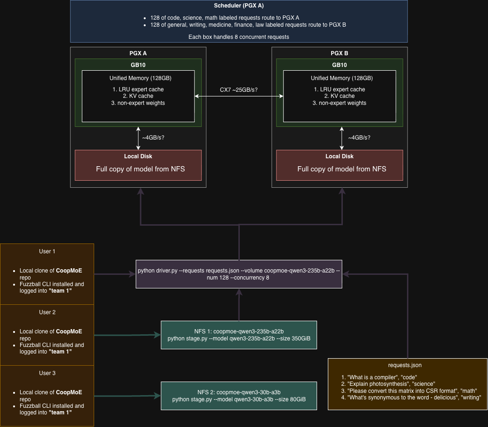

# CoopMoE: cooperative expert caches on two PGX boxes

Two DGX Spark (GB10) boxes serve concurrent requests to an MoE model that is larger than both
boxes' memory combined: Qwen3-235B-A22B FP8 has ~227 GB of experts, against ~85 GB of expert
cache per box.

- **Both boxes serve.** Each box runs its own requests, several at a time (`--concurrency`,
  default 4), batched.
- **Requests are split by category.** Every request is labeled (code, math, writing, ...), and
  the run config fixes which categories each box serves. Similar requests land on the same box,
  so the two boxes' caches hold different experts.
- **A box that misses asks the other box before its own disk.** The other box runs the expert
  where it sits, so only kilobytes of activations cross the link.



**Built on Hugging Face transformers (5.23.0).** Each box runs HF's `Qwen3MoeForCausalLM`
under HF's continuous batching (the loop `transformers serve` uses), with one change: each
layer's `mlp.experts` is replaced, so the router's top-k choice goes to CoopMoE's expert path
(own cache, other box, own disk) instead of HF's resident expert weights. Attention, routing,
KV cache, batching, sampling and the tokenizer are HF's. Vanilla HF is then a like-for-like
baseline: the same model and batching loop with the stock experts.

## Running it

Run from any machine where the `fuzzball` CLI is logged in to the cluster. `stage.py` and
`driver.py` need only the Python standard library; `make_requests.py` needs `datasets`, hence
the venv.

```bash
# Setup
python3 -m venv .venv
source .venv/bin/activate
pip install datasets

python make_requests.py --out data/requests.json  # once: labeled requests
python stage.py --model qwen3-235b-a22b --size 350GiB  # once per model
python driver.py --requests data/requests.json --volume coopmoe-qwen3-235b-a22b --num 16 --concurrency 8
```

**[stage.py](stage.py)** `--model` (`qwen3-235b-a22b` or `qwen3-30b-a3b`) `--size` (both required)
1. Makes sure the model has its own NFS volume, `team1/coopmoe-<model>`: created at `--size` if
   missing, grown to it if smaller, never shrunk. Size it for the store (~243 GB for 235B,
   ~31 GB for 30B) plus results.
2. Submits [fuzzball/stage.fz](fuzzball/stage.fz): one node downloads the checkpoint to its
   temporary disk and converts it into the expert store on the volume. It then stops; it runs
   no experiment. Running it again is harmless: a finished store is skipped.

**[driver.py](driver.py)** `--requests` `--volume` (required) `--num` (requests per box, default 64)
`--concurrency` (requests each box serves at a time, batched; default 4, from the run config)
1. Reads the model from the volume name, and picks `--num` requests for each box from its
   categories. Each box serves `--concurrency` of them at a time; each one in flight holds a KV
   cache (~1.5 GB for 235B at 8k tokens), so raising it may mean lowering `cache.gb`.
2. Submits [fuzzball/coopmoe.fz](fuzzball/coopmoe.fz): one job on two nodes. The repo's code
   and the requests travel inside the workflow file.
3. Inside the job, [fuzzball/bootstrap.sh](fuzzball/bootstrap.sh) runs on each node. Both
   nodes copy the store from the NFS volume to their own temporary disk (`/local`) and start
   their engine. PGX-A then runs the requests through the scheduler and prints the results
   into the job log.
4. Follows the log, then writes `results/<model>-<time>/`:
   - `report.md`: throughput, time per token, time to first token, latency, where experts
     came from (own cache / other box / disk), cache overlap
   - `<setup>_outputs.jsonl`: one line per request, with its timings and generated text
   - `<setup>.json`, `overlap.csv`, `requests.json`, `coopmoe.fz`, `job.log`

Everything else is fixed in `SETTINGS` at the top of `driver.py` (provisioner `team1`, mounts,
image, 1 GPU / 20 cores / 120 GiB per node, timeouts), and `stage.py` uses the same values.
To change the engines or the scheduler (`cache.gb`, link on/off, routing mode), edit the
model's run config in [configs/](configs/).

## The cluster (fb-hack)

- ~28 DGX Sparks: one GB10 GPU, 20 Arm cores and ~128 GiB of unified memory each. A 2-node
  job's hostnames are `<job>-0`, `<job>-1` (`run-0`, `run-1` here).
- Persistent volumes are on NFS (`10.10.11.1:/hackathon/team-01`), the same files on both
  boxes. A box's own disk is only reachable as an `ephemeral` volume, wiped when the job ends.
  Hence: build the store once on NFS, copy it to each box at job start.
- Memory requests are hard limits, and the GPU allocates from the same memory.
- Fuzzball treats a double brace anywhere in a workflow file (comments too) as a template.
- The old shared volume `coopMoE` (200 GB) is no longer used by the scripts; only the
  temporary smoke test ([fuzzball/tests/smoke.fz](fuzzball/tests/smoke.fz)) still mounts it.

## How a box handles each expert a layer needs

1. **In its own cache:** run it here.
2. **Only in the other box's cache** (per that box's last residency bitmap): send it in this
   layer's single message to the other box, which runs it and sends back the partial result.
   - If the other box evicted it meanwhile, it replies `MISS` and this box reads it from disk.
   - If the other box is slower per expert than a disk read, read from disk instead (and
     re-check every 32 layers).
3. **In neither:** read it from this box's disk and run it. While generating it is admitted to
   the cache; while reading the prompt it goes to a temporary buffer, so a prompt does not
   flush the cache.

Two rules sit on top of the LRU cache:

| rule | setting | default |
|---|---|---|
| Admission: copy an expert from the other box once this box has sent it there k times within W steps | `cache.admit_k`, `cache.admit_window` | 3, 64 (`0` = never) |
| Duplicate-first eviction: evict an expert the other box also holds before one only this box holds | `cache.dup_first` | on |

Each request is a single turn: the prompt, then exactly `bench.max_new_tokens` generated
tokens, so every setup does the same work. All requests are queued at the start; a box serves
`--concurrency` at a time, and a request whose box is full waits rather than moving to the
other box.

## Requests and model

[make_requests.py](make_requests.py) writes `{id, category, source, request,
reference}` records from public Hugging Face datasets, each about one subject: code, math,
science, medicine, finance, law, writing, general, and chinese (served by no box by default).
The category → box split is in the run config (`router.box_categories`), so it can change
without regenerating the file.

- **Target:** Qwen3-235B-A22B-Instruct-2507 FP8 (94 layers × 128 experts, top-8).
- **Development:** Qwen3-30B-A3B-Instruct-2507 FP8 (48 layers × 128 experts, top-8).

## Layout

```
stage.py            once per model: its NFS volume + the expert store on it
make_requests.py    once: labeled requests from public datasets -> data/requests.json
driver.py           one experiment: requests + volume -> Fuzzball job on both boxes -> results/
fuzzball/           stage.fz, coopmoe.fz (job templates), bootstrap.sh (what each node runs),
                    tests/smoke.fz (temporary cluster check)
coopmoe/            the engine, run inside the jobs as python -m coopmoe stage | engine | run
  run.py            the experiment on PGX-A: engine, requests through the scheduler, report
  router.py         scheduler: category -> box, or round-robin; --concurrency slots per box
  engine.py         one box: HF continuous batching, step hooks, message server
  moe.py            per expert: own cache / other box / own disk, and serving the other box
  cache.py          the LRU expert cache, duplicate-first eviction, residency bitmap
  peer.py           the link to the other box, and the admission rule
  model.py          HF Qwen3-MoE with each layer's experts swapped for CoopMoE's
  store/            store format, checkpoint -> store converter, fast disk reader
  transport.py      TCP messages; bench.py, report.py: measurements and results;
                    workload.py: request selection and chat format; config.py, stats.py, cli.py
configs/            qwen3_235b_a22b_fp8.json (target), qwen3_30b_a3b_fp8.json (development)
setup.sh, env.sh    the job's Python environment (reuses the image's torch; needs Python >= 3.11)
```

To run the engine on one machine (a tiny model on CPU), do what `bootstrap.sh` does with
addresses `127.0.0.1:29600,127.0.0.1:29601`: `python -m coopmoe engine --rank 1 ...` in the
background, then `python -m coopmoe run ...`.
